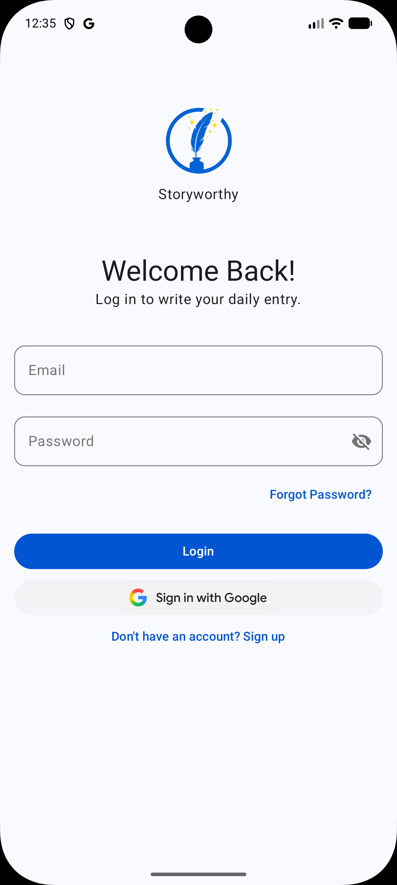
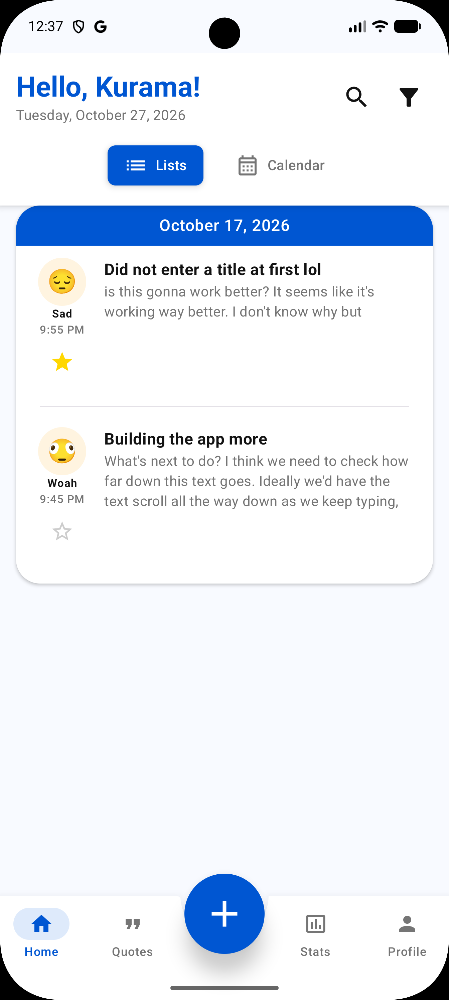
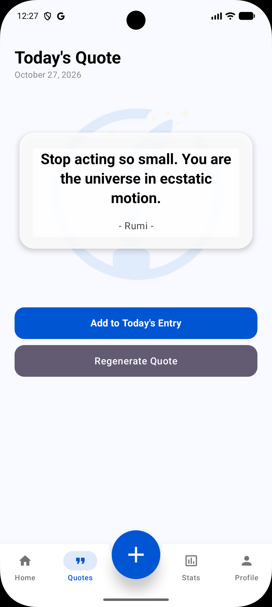
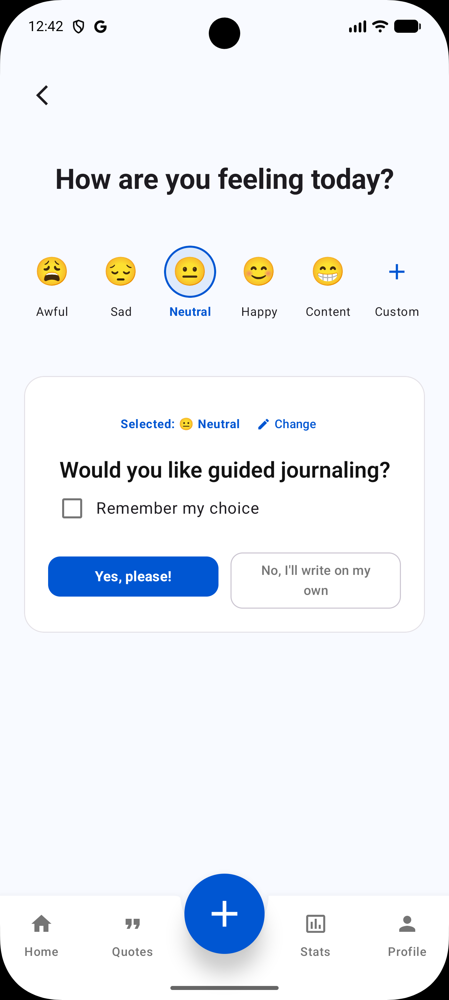
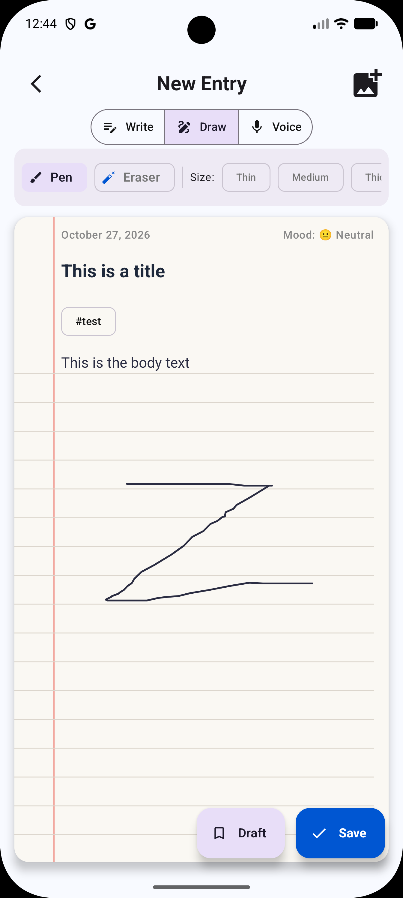
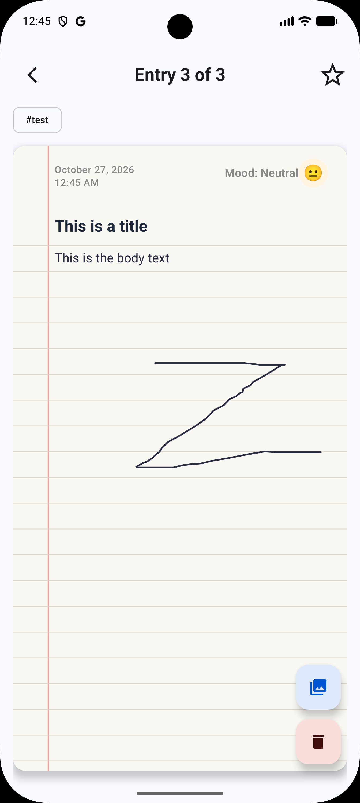
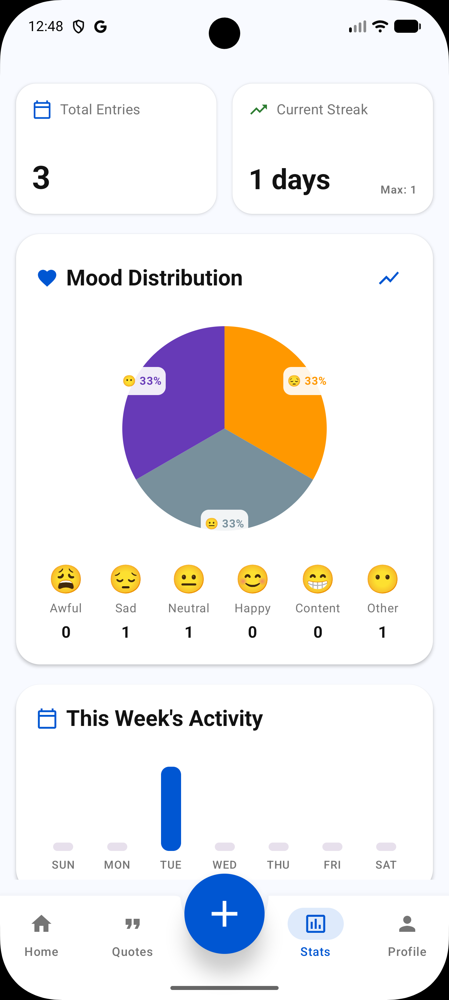

> Note that this application is still in development. Some features may be incomplete.

## Table of Contents

# Storyworthy

An Android application made for diarists, from aspiring to advanced. Write entries daily and feel
its cognitive benefits.

Journaling on pen and paper can feel overwhelming for new users, who may not know where to start.
Storyworthy aims to address this hurdle by providing an assistant that asks thought-provoking
questions about the user's provided context, allowing them to: 
- Establish a starting point for their writing 
- Experience input options that are even more freeform than pen and paper.  

Current solutions on the market suffer from the following:
- **Inaccessibility**. New diarists may struggle to know where to start when staring at a blank page. 
Storyworthy addresses this by giving users an optional AI assistant to nudge them in a direction that
can get their creative writing flowing.

- **Privacy concerns**. Users could theoretically journal their thoughts in the popular LLMs, but 
there are reasonable worries about giving sensitive information to them. Storyworthy addresses this
by having all AI prompts be in a fresh session, independent of user accounts. Additionally, prompts are 
generated with keywords and mood only, preventing LLMs from obtaining a fingerprint. All entry data 
is saved and secured in a Firebase Realtime Database, where user data is not sold for profit.

- **Limited recollection/thought tracking**. Dedicated diarists can fill up several journals by
themselves, making it become ever-harder to locate certain entries or assess if and how the
journaling process has improved their mood. Storyworthy addresses this by having a sentiment and
semantic-based lookup of entries, allowing users to filter through entries far faster than they
could in a physical journal. There is also a favorite feature for users to pin poignant entries to
the top of their view.

---

## Getting Started

--- 

## Usage

### Home

Once entering the app, you will be prompted to Sign In. If you have an account, log in with your
email and password credentials. Otherwise, you can create an account manually or create an account
with Google.

The home page chronicles your entry history. You are able to change the view to a list or calendar
view. Entries can be searched by mood, sentiment, or date to lookup entries quickly. Entries can
also be filtered by favorites, tags, or moods in the list view to best tailor their homepage to what
they wish to see. 

### Quotes

Users are provided with a daily quote from a library of inspirational quotes that can be a source of
daily encouragement. If users do not like the displayed quote, they can regenerate the quote to find
one they like. These quotes can also be added to an entry.

### Add Entry

Users are prompted to select an appropriate mood for how they are feeling, and if they would like AI
to assist them in the journaling process. If 'no' is selected, users can proceed to freeform writing 
their entry. Otherwise, both the current mood and recent entry context (if any exists) will be
provided to AI to help users brainstorm on a topic to write about.

### Write Entry

Users are able to write, draw, and/or record audio to tie into their entry for the day. Users are
also able to add tags and images to their entry. If the user feels like they are done, they are able
to post their entry. Otherwise, they can leave it for later by saving it as a draft.

### View Entry

View entries exactly as they were saved in chronological order, with options to view images/tags, set or remove an entry as a
favorite, and delete the entry.

### Stats

Review your journal history at a glance; highlights the total entries, the current journaling streak
(as well as the longest streak held), a visualized distribution of selected moods, and a bar graph
highlighting the number of entries per day.

### Profile
View current profile settings, with options to edit one's profile, log out, or delete all user data.

## Acknowledgements
A big thanks goes out to Jiewan, Rohit, Shreyas, Raihan, and Edgar for helping this project come to
life.

### Checklist
- [] Assess working state of login/sign up 
- [x] Build view entry page, have "page flip" functionality
- [x] Build entry search functionality
- [] Finish settings screen
- [] Add sanity check functionality (confirm log out, etc.)
- [x] Build stats page
- [x] Update UI and icons to reflect their functions better
- [] Optimize app performance (rewrite functions as needed, save localStorage, etc.)
- [] Optimize code (refactor, write reusable functions, etc.)
- [] Add fun, informative animations